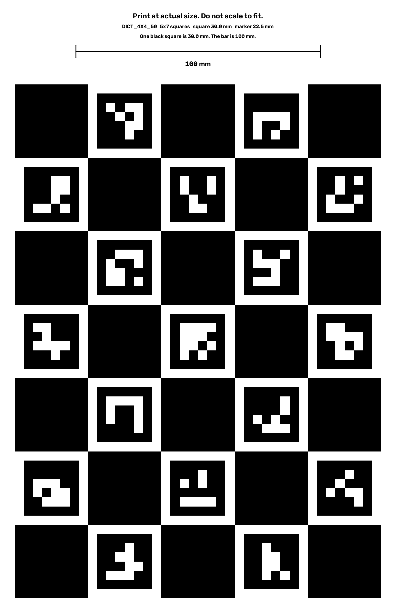

# ChArUco board

Prints a ChArUco sheet with squares of a known size, and the spec `tool-charuco-camera-calibration` reads with `--spec`.

Default sheet: **5×7** squares, **30 mm** square, **22.5 mm** marker, **DICT_4X4_50**. The PDF is smaller than US Letter so the printer does not shrink it into the margins.

## Setup

Python **3.10+**.

```bash
uv sync
uv run python main.py
```

Writes `outputs/charuco-board.pdf` and `outputs/charuco-board.yml`.

## IMPORTANT

- Print at **actual size (100%)** on **US Letter**.
- **Do not scale to fit.** Blank margins around the sheet are expected.
- The bar on the sheet is **100 mm**. If it is not, the squares are not 30 mm.


